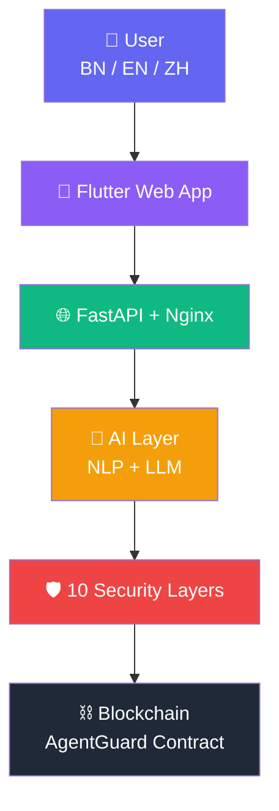

# 🛡️ Sentinel Wallet AI

**Autonomous On-Chain Financial Agent with Hard Security Constraints**

[]()
[]()
[]()
[]()
[]()
[]()

---

## 🎯 Overview

**Sentinel Wallet AI** is an autonomous AI agent that owns its own Ethereum wallet, executes real on-chain transactions, and manages personal finances — all within hard security constraints that make it impossible for the AI to drain funds or violate user rules.

**Competition:** 2026 Shenzhen International FinTech Competition (FinTechathon)  
**Track:** International  
**Topic:** F — Agent Wallet (Autonomous On-chain Wallet)  
**Team:** juwel-ux

---

## 🏗️ Architecture



📖 **Full architecture:** [docs/architecture.md](docs/architecture.md)  
🔒 **Security report:** [docs/security-report.md](docs/security-report.md)  
📊 **Features list:** [docs/features.md](docs/features.md)

---

## 🚀 Quick Start

### Prerequisites

- **Docker** — [Install](https://docs.docker.com/get-docker/)
- **Docker Compose** — [Install](https://docs.docker.com/compose/install/)

### Run in 3 Commands

```bash
# 1. Clone repository
git clone https://github.com/juwel-ux/sentinel-wallet-ai.git
cd sentinel-wallet-ai

# 2. Setup environment
cp .env.example .env

# 3. Start everything
docker-compose up
```

### Wait for Services (2-3 minutes)

Docker will automatically start:

- ✅ **Ganache** — Local Ethereum blockchain
- ✅ **Ollama** — Local LLM (downloads `llama3.2:3b`)
- ✅ **Smart Contract** — Auto-deployed
- ✅ **FastAPI** — Backend server
- ✅ **Nginx** — Frontend server

### Open in Browser

| Service | URL |
|---------|-----|
| 🖥️ **Flutter Web App** | http://localhost:8080 |
| 🌐 **API** | http://localhost:8000 |
| ❤️ **API Health** | http://localhost:8000/health |

---

## 🧪 Test the AI

**In the web app, type:**

```
Hello
```

**Or use curl:**

```bash
# API health
curl http://localhost:8000/health

# Chat in Bengali
curl -X POST http://localhost:8000/command \
  -H "Content-Type: application/json" \
  -d '{"text": "Hello", "language": "bn"}'

# Send ETH
curl -X POST http://localhost:8000/command \
  -H "Content-Type: application/json" \
  -d '{"text": "send 0.009 ETH to rahim", "language": "en"}'
```

---

## ✨ Features

### 💼 Financial Assistant (Topic A)

- 📊 Accounting & expense tracking
- 💰 Budget management
- 📈 Forecasting
- 🧠 Right/wrong advice
- 📅 Bill scheduling
- 📱 Portfolio monitoring

### 🤖 Financial Participant (Topic F)

- 💸 Autonomous on-chain transfers
- 🔄 Token swaps
- 📥 Deposit / Withdraw
- 📱 QR code generation
- ⛽ Gas estimation
- 🌐 Multi-chain support
- 💱 Currency conversion
- 🏦 Wallet creation

### 🛡️ Security — 10 Layers

| # | Layer | Purpose |
|---|-------|---------|
| 1 | **Verifier Agent** | Independent AI verification |
| 2 | **Simulation Engine** | Dry-run before broadcast |
| 3 | **Session Budget** | Cumulative limit |
| 4 | **Prompt Injection Guard** | Blocks hidden instructions |
| 5 | **Anomaly Detection** | Behavior monitoring |
| 6 | **Proof-Gated Signing** | Policy proof before signing |
| 7 | **Drain Taxonomy** | 8 attack types blocked |
| 8 | **Compliance** | KYC + sanctions check |
| 9 | **Audit Trail** | Tamper-proof hash chain |
| 10 | **Contract Constraints** | On-chain enforcement |

### 🧠 Intelligence

- 🗣️ **NLP in Bengali · English · Chinese**
- 🎙️ Voice input/output
- 🤖 LLM-powered conversation (Ollama)
- 🔧 Self-correction engine
- 💬 Conversational responses

---

## 📁 Project Structure

```
sentinel-wallet-ai/
├── ai-agent/              # Python AI agent
│   └── features/          # 30+ modules
├── contracts/             # Solidity smart contracts
├── frontend/              # Flutter Web build
├── scripts/               # Deployment scripts
├── docs/                  # Documentation
├── solcx/                 # Pre-downloaded Solidity compiler
├── api_server.py          # FastAPI server
├── docker-compose.yml     # One-command deploy
├── Dockerfile             # Container definition
├── start.sh               # Auto-deploy script
└── README.md
```

---

## 🔧 Manual Setup (Without Docker)

**For advanced users:**

```bash
# 1. Python environment
python -m venv venv
source venv/bin/activate
pip install -r requirements.txt

# 2. Install Solidity compiler
python -c "import solcx; solcx.install_solc('0.8.19')"

# 3. Start Ganache (in another terminal)
ganache --port 7545

# 4. Deploy contract
python scripts/deploy_contract.py

# 5. Start API
python api_server.py

# 6. Start Ollama (in another terminal)
ollama serve
ollama pull llama3.2:3b
```

---

## 🧬 Technology Stack

| Layer | Technology |
|-------|-----------|
| **Frontend** | Flutter 3.47, Dart, Material 3 |
| **Backend** | Python 3.11, FastAPI, Web3.py |
| **AI** | Ollama, llama3.2:3b, NLP |
| **Voice** | SpeechRecognition, gTTS |
| **Blockchain** | Solidity 0.8.19, Ethereum, Ganache |
| **DevOps** | Docker, Docker Compose, Nginx |

---

## 🏆 Competition

**2026 Shenzhen International FinTech Competition (FinTechathon)**

- **Host:** Tsinghua University PBC School of Finance + WeBank
- **Theme:** AI as a Financial Participant
- **Topic:** F — Agent Wallet (Autonomous On-chain Wallet)
- **Prize Pool:** RMB 250,000

---

## 📚 Documentation

- [Architecture](docs/architecture.md)
- [Security Report](docs/security-report.md)
- [Features](docs/features.md)
- [Setup Guide](docs/setup-guide.md)
- [API Reference](docs/api-reference.md)
- [Demo Script](docs/demo-script.md)

---

## 📄 License

MIT License — see [LICENSE](LICENSE)

---

## 👤 Author

**Juwel** ([@juwel-ux](https://github.com/juwel-ux))

---

**Built with ❤️ for FinTechathon 2026**
