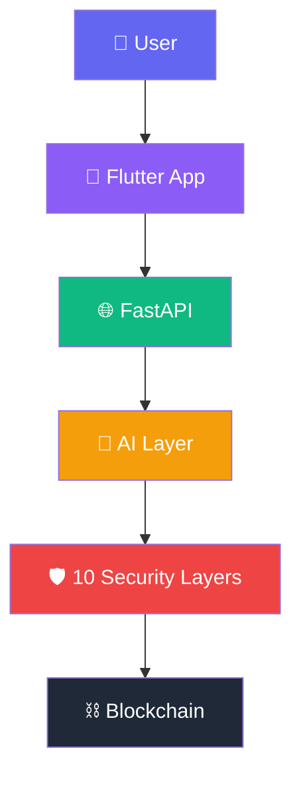

# Sentinel Wallet AI

**Autonomous On-Chain Financial Agent with Hard Security Constraints**

[]()
[]()
[]()
[]()
[]()
[]()

---

## 🎯 Overview

Sentinel Wallet AI is an autonomous AI agent that owns its own Ethereum wallet, executes real on-chain transactions, and manages personal finances — all within hard security constraints that make it impossible for the AI to drain funds or violate user rules.

**Competition:** 2026 Shenzhen International FinTech Competition  
**Topic:** F — Agent Wallet (Autonomous On-chain Wallet)

---

## 🏗️ Architecture



📖 **Full architecture:** [docs/architecture.md](docs/architecture.md)  
🔒 **Security report:** [docs/security-report.md](docs/security-report.md)

---

## 🚀 Quick Start

```bash
git clone https://github.com/YOUR_USERNAME/sentinel-wallet-ai.git
cd sentinel-wallet-ai
cp .env.example .env
docker-compose up
```

**Open:** [http://localhost:8080](http://localhost:8080)

That's it. Docker will start **Ganache**, **Ollama**, **FastAPI** and **Nginx** automatically.

---

## ✨ Features

### Financial Assistant
- 📊 Accounting & expense tracking
- 💰 Budget management
- 📈 Forecasting
- 🧠 Right/wrong advice
- 📅 Bill scheduling

### Financial Participant
- 💸 Autonomous on-chain transfers
- 🔄 Token swaps
- 📥 Deposit / Withdraw
- 📱 QR code generation
- ⛽ Gas estimation
- 🌐 Multi-chain support

### Security — 10 Layers
1. ✅ Verifier Agent
2. ✅ Simulation Engine
3. ✅ Session Budget
4. ✅ Prompt Injection Guard
5. ✅ Anomaly Detection
6. ✅ Proof-Gated Signing
7. ✅ Drain Taxonomy Defense
8. ✅ Compliance (KYC)
9. ✅ Cryptographic Audit Trail
10. ✅ Smart Contract Constraints

### Intelligence
- 🗣️ NLP in **Bengali · English · Chinese**
- 🎙️ Voice input/output
- 🤖 LLM-powered conversation (Ollama)
- 🔧 Self-correction engine

---

## 🧪 Testing

```bash
# API health
curl http://localhost:8000/health

# Chat
curl -X POST http://localhost:8000/command \
  -H "Content-Type: application/json" \
  -d '{"text": "Hello", "language": "bn"}'
```

---

## 📁 Project Structure

```
sentinel-wallet-ai/
├── ai-agent/              # Python AI agent
│   └── features/          # 30+ modules
├── contracts/             # Solidity contracts
├── frontend/              # Flutter Web build
├── scripts/               # Deployment
├── docs/                  # Documentation
├── api_server.py          # FastAPI
├── docker-compose.yml     # One-command deploy
└── README.md
```

---

## 📄 License

MIT — see [LICENSE](LICENSE)

---

**Built with ❤️ for FinTechathon 2026**


