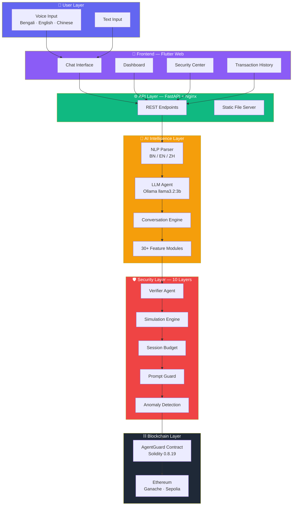
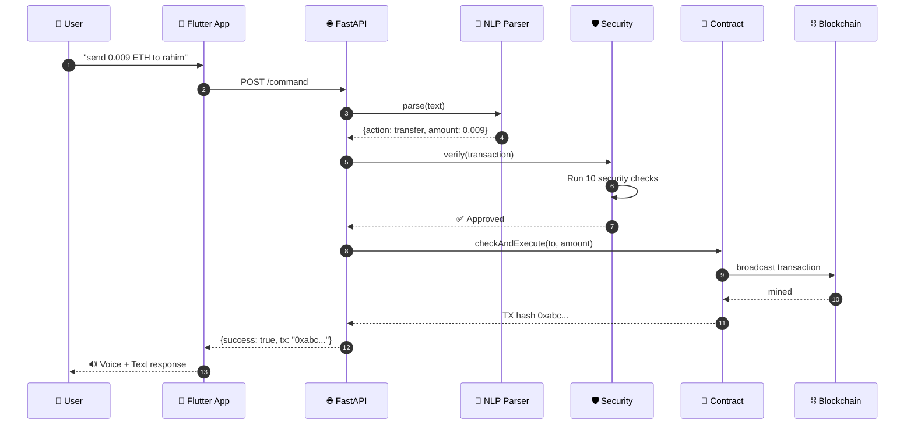
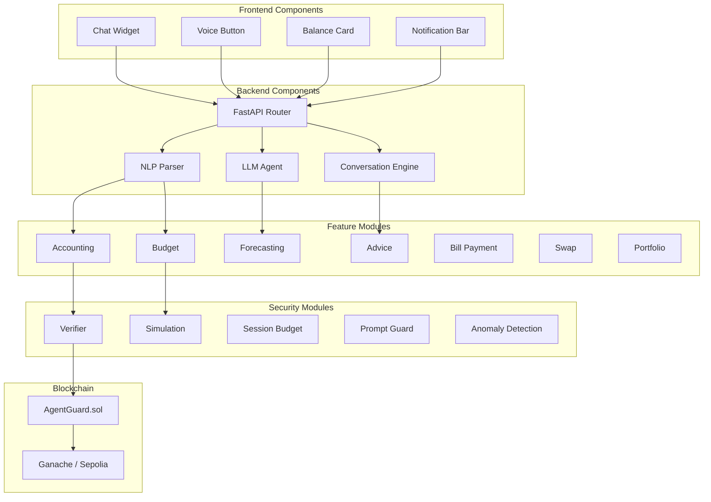
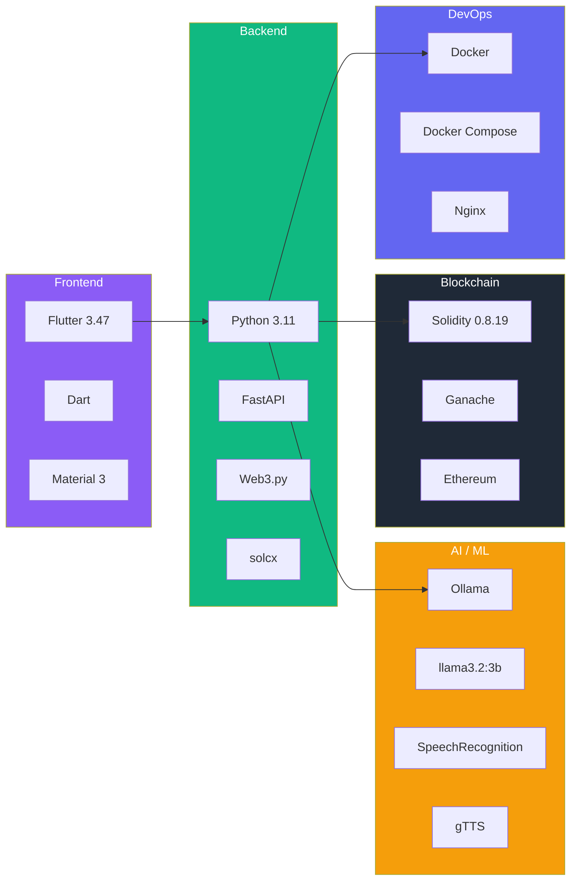
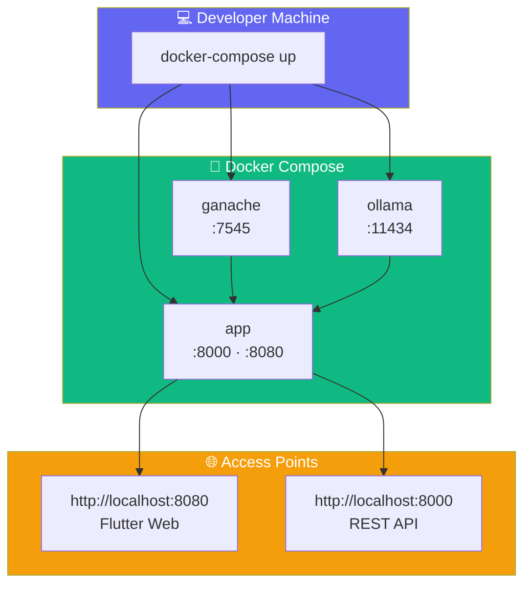

# Sentinel Wallet AI — System Architecture

> **Autonomous On-Chain Financial Agent with Hard Security Constraints**

---

## 1. High-Level System Architecture

---

## 2. Security Pipeline — 10 Layers

Every transaction must pass **all 10 layers** before execution:

```mermaid
flowchart LR
    Start([User Command]) --> L1
    L1[1 · Verifier] --> L2[2 · Simulation]
    L2 --> L3[3 · Session Budget]
    L3 --> L4[4 · Prompt Guard]
    L4 --> L5[5 · Anomaly]
    L5 --> L6[6 · Proof-Gated]
    L6 --> L7[7 · Drain Taxonomy]
    L7 --> L8[8 · Compliance]
    L8 --> L9[9 · Audit Trail]
    L9 --> L10[10 · Smart Contract]
    L10 --> End([✅ Transaction Executed])

    style Start fill:#6366F1,color:#fff
    style End fill:#10B981,color:#fff
    style L1 fill:#EF4444,color:#fff
    style L2 fill:#F59E0B,color:#fff
    style L3 fill:#F59E0B,color:#fff
    style L4 fill:#F59E0B,color:#fff
    style L5 fill:#F59E0B,color:#fff
    style L6 fill:#EF4444,color:#fff
    style L7 fill:#EF4444,color:#fff
    style L8 fill:#EF4444,color:#fff
    style L9 fill:#EF4444,color:#fff
    style L10 fill:#8B5CF6,color:#fff
```

---

## 3. Transaction Sequence — End-to-End

---

## 4. Component Architecture

---

## 5. Technology Stack

---

## 6. Layer Summary

| # | Layer | Technology | Purpose |
|---|-------|-----------|---------|
| 1 | **User** | Voice + Text | Input in 3 languages |
| 2 | **Frontend** | Flutter Web | Cross-platform UI |
| 3 | **API** | FastAPI + Nginx | REST + static |
| 4 | **AI** | Ollama + NLP | Language understanding |
| 5 | **Features** | Python | 30+ modules |
| 6 | **Security** | Python + Solidity | 10-layer protection |
| 7 | **Blockchain** | Ethereum | On-chain execution |
| 8 | **DevOps** | Docker | One-command deploy |

---

## 7. Deployment Architecture

---

**© 2026 Sentinel Wallet AI — FinTechathon Submission**
