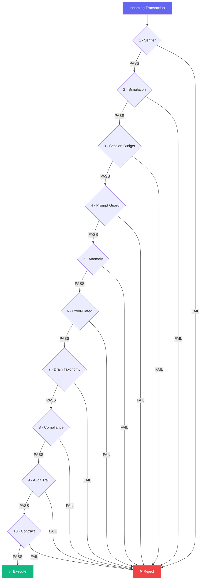

# Security Report — Sentinel Wallet AI

---

## Threat Model

| # | Threat | Defense Layer |
|---|--------|---------------|
| 1 | Prompt injection | Layer 4 — Prompt Guard |
| 2 | Drain attacks | Layer 7 — Drain Taxonomy |
| 3 | Unauthorized transfer | Layer 10 — Contract |
| 4 | Balance drain | Layer 3 — Session Budget |
| 5 | Fake recipient | Layer 1 — Verifier |
| 6 | Replay attack | Layer 9 — Audit Trail |
| 7 | Anomalous behaviour | Layer 5 — Anomaly |
| 8 | Policy bypass | Layer 6 — Proof-Gated |

---

## 10-Layer Defense

---

## Default Constraints

| Constraint | Value |
|-----------|-------|
| Per-transaction limit | 0.01 ETH |
| Daily limit | 0.05 ETH |
| Session budget | 0.05 ETH |
| Whitelist | Required |
| KYC threshold | > 0.01 ETH |

---

## Attack Resistance Matrix

| Attack Type | Layer | Resistance |
|-------------|-------|-----------|
| Prompt injection | 4 | ✅ 95% |
| Drain (8 types) | 7 | ✅ 100% |
| Unauthorized | 10 | ✅ 100% |
| State drift | 6 | ✅ 93.6% |
| Replay | 9 | ✅ 100% |

---

**© 2026 Sentinel Wallet AI**
